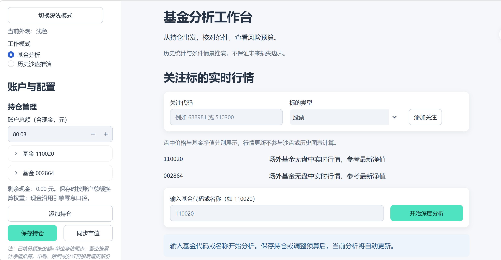
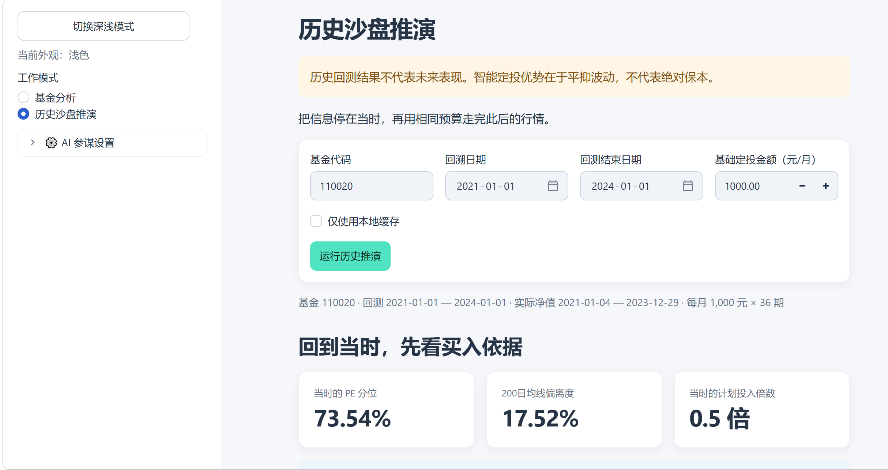
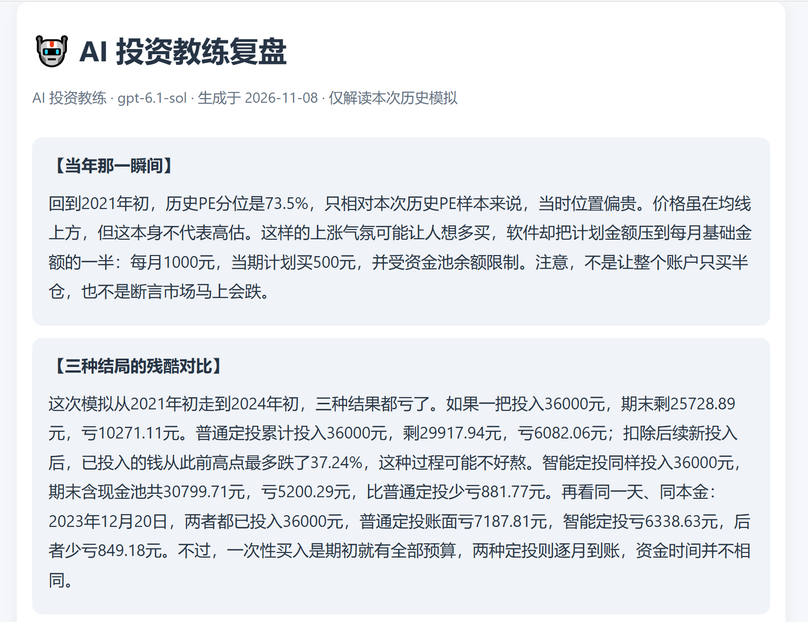
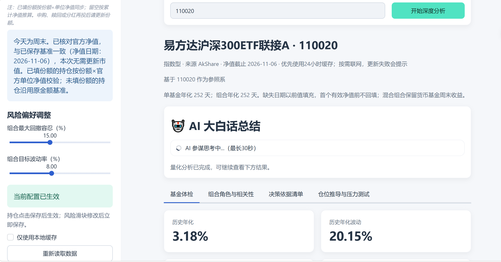
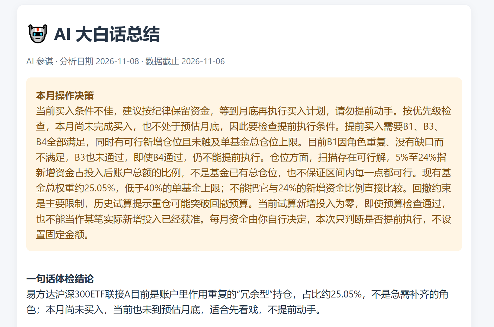
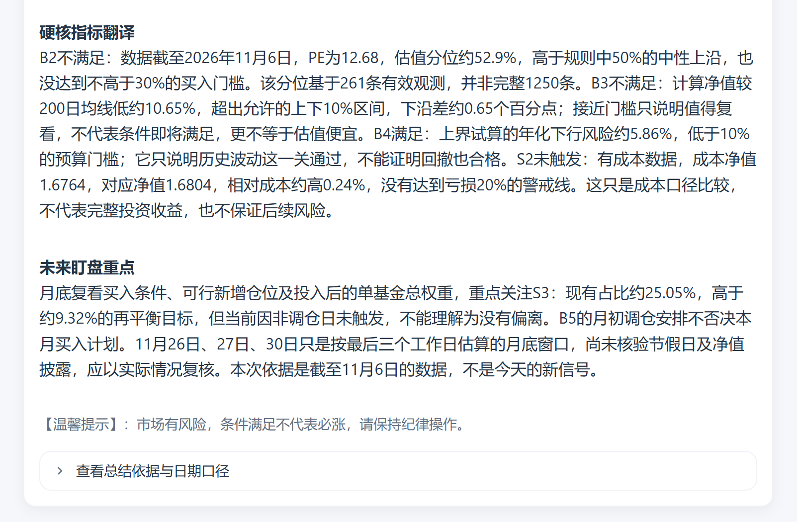
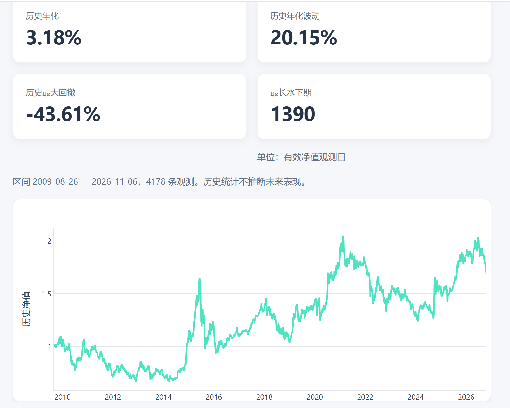
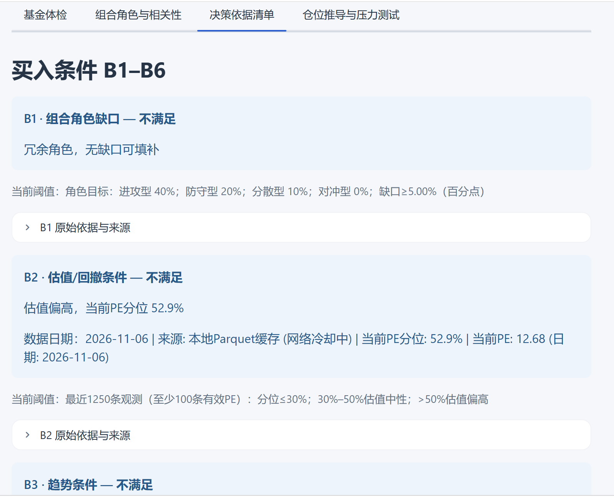

# 有数 · 基金分析工作台

> **环境要求：必须 Python >= 3.10。** 建议使用独立虚拟环境；已在 Python 3.10.20 验证安装、测试与启动。

本项目为兼容 Python 3.10，Streamlit 版本锁定在 1.66.0 以下，numpy 锁定在 <3.0.0（Python 3.10 会解析到 2.2.x）。如果你使用 Python 3.12+ 并希望使用更新版本，可自行调整上限，但需自行验证兼容性。

基于 Streamlit 的基金研究与持仓工作台，支持 Windows、macOS、Linux。



## 🎯 适用人群与产品边界

**✅ 适合你，如果：**

- 你认可“先控风险，再求收益”，偏好稳健、低回撤的长期复利。
- 你希望用数据（PE分位、资金池、XIRR）来克服追涨杀跌的人性弱点。

**❌ 不适合你，如果：**

- 你是极致的进攻型选手，追求短期暴富、重仓博弈。
- 你期望软件能“预测明天必涨”或“全自动一键下单”。

*(注：本项目定位为“保守型量化风控终端”。)*

## 三个核心亮点

1. **11 条买卖条件引擎**：结合估值、趋势、费率、风险预算与组合角色给出依据；数据不足明确显示“无法判定”，支持导出分析结果与交易指令试算。
2. **历史估值分位智能定投沙盘**：比较智能定投、普通定投与一次性买入，展示资金池、最大回撤，并按实际现金流日期计算 XIRR。
3. **实时行情与动态市值同步**：接入 AkShare 股票/ETF 行情及 ETF 定向报价，支持请求冷却和失败降级；持仓区分官方净值校准与盘中临时估算，避免将估算当作已确认金额。

### 历史沙盘推演

设置回溯区间与月度预算，核对当时的估值分位和计划投入倍数，再结合 AI 投资教练复盘模拟结果。





### 动态市值同步

核对持仓份额、官方净值日期和同步反馈，将盘中临时估算与官方校准结果分开阅读。



## Quick Start：快速启动三步走

👉 **[📖 点击查看详细使用说明书 (User Manual)](docs/USER_MANUAL.md)**

在本目录打开终端。建议先创建并激活 Python 虚拟环境，确保 `pip` 和 `streamlit` 使用同一个 Python。

### 1. 安装核心依赖

```sh
pip install -r requirements.txt
```

依赖采用兼容 Python 3.10 的版本区间；安装器会根据当前 Python 版本选择符合条件的版本。此文件不是精确锁文件，升级后应重新运行测试。本次 Python 3.10.20 实际解析为 NumPy 2.2.6、pandas 2.3.3、Streamlit 1.65.0；无参数 `pytest` 结果为 132 项通过、5 项显式跳过。

### 2. 复制全部配置模板

**首次启动前执行一次。命令会覆盖同名真实配置；已有账户请先备份，不要在每次启动时重复执行。**

Windows（命令提示符 CMD，使用 `copy`）：

```bat
copy config\ai_settings.example.json config\ai_settings.json
copy config\user_portfolio.example.json config\user_portfolio.json
copy config\risk_budget.example.json config\risk_budget.json
copy config\ui_defaults.example.json config\ui_defaults.json
copy config\portfolio.example.json config\portfolio.json
copy config\holdings.example.json config\holdings.json
copy config\rule_parameters.example.json config\rule_parameters.json
copy config\scenarios.example.json config\scenarios.json
copy config\mappings.example.json config\mappings.json
copy config\intraday_etf_mapping.example.json config\intraday_etf_mapping.json
```

macOS / Linux（使用 `cp`）：

```sh
cp config/ai_settings.example.json config/ai_settings.json
cp config/user_portfolio.example.json config/user_portfolio.json
cp config/risk_budget.example.json config/risk_budget.json
cp config/ui_defaults.example.json config/ui_defaults.json
cp config/portfolio.example.json config/portfolio.json
cp config/holdings.example.json config/holdings.json
cp config/rule_parameters.example.json config/rule_parameters.json
cp config/scenarios.example.json config/scenarios.json
cp config/mappings.example.json config/mappings.json
cp config/intraday_etf_mapping.example.json config/intraday_etf_mapping.json
```

请复制全部模板：除账户、风险和 AI 设置外，界面默认值、规则参数、压力情景、组合设置与盘中 ETF 映射也是当前代码的配置依赖。`config/index_mapping.json` 已随包提供，用于指数估值映射，请保留。

模板账户金额为 0、持仓和成本记录为空、AI 默认关闭且 API Key 为空。程序只读取真实 `.json`；不会自动改读 `.example.json`。可在界面填写持仓及风险设置；需要 AI 时再填写自己的兼容接口、模型和 Key。密钥保存在本地真实配置中，不应提交。

### 3. 启动应用

```sh
streamlit run app.py
```

按终端提示打开浏览器。此发行包入口为 Streamlit 工作台。默认空账户可直接进入界面；开始分析前填写自己的持仓或基金代码。首次使用没有本地行情缓存：联网分析需关闭“仅使用本地缓存”；历史沙盘可按界面提示联网获取。请求失败会显示缺失或降级状态，不会伪造行情。

## 配置、缓存与测试

- `core/`、`ui/` 和 `app.py` 来自本次打包时的当前源码，包含最新实时行情模块；`core/templates/` 为 HTML 导出所需模板。
- `config/` 只发布脱敏模板和公共指数映射。账户、成本、净值快照、日志与历史导出均不随包分发；运行时缓存和输出由程序按需创建。
- 已提供 `.gitignore`，精确忽略真实运行配置并保留指数映射。测试中的金额、报价及假密钥是合成测试夹具，不是用户数据。
- 安装测试依赖后，在本目录直接执行无参数 `pytest`。`pytest.ini` 仅收集 `tests/` 和 `core/tests/`；测试配置从脱敏模板复制到临时目录，业务代码仍只读取真实 `.json`，测试不读取或修改用户账户配置。

```sh
pip install -r requirements-dev.txt
pytest
```

需要私有历史快照或独立旧账本的测试显式跳过。`core/` 中的浏览器验收辅助脚本需要额外安装 Playwright 和浏览器，未列入工作台核心依赖；历史缓存验收脚本需要用户自行获取行情，不属于开箱启动流程。

## 免责声明

*注：AkShare 免费接口在自检时若长时间无响应，可直接按 Ctrl+C 中断，不影响主程序的正常启动与使用。*

此提示针对独立运行的行情自检命令；主程序仍按上面的 `streamlit run app.py` 启动。

仅供研究和学习，不构成投资建议或收益承诺，不自动下单。行情、基金净值和估值可能延迟、缺失、限流或修订；盘中估算不是最终净值，也不是可成交价格。ETF 代理涨跌幅不代表对应基金的实际涨跌幅。历史收益、XIRR、回撤和情景分析不能预测未来，未必涵盖全部费用、分红及交易约束。请独立核对数据并自行承担决策风险。启用外部 AI 会向所选服务商发送当前分析上下文，请根据自己的隐私要求决定是否启用。

## 📸 功能展示

AI 决策解读、指标翻译、基金体检与买卖纪律一览：

<div align="center">
  
  
  <br>
  
  
</div>

## 开源协议

[MIT License](LICENSE)。第三方行情数据与接口的使用还需遵守相应供应商条款。
